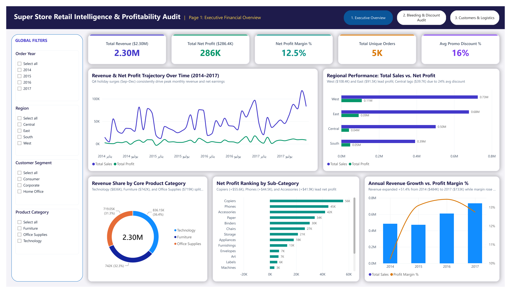
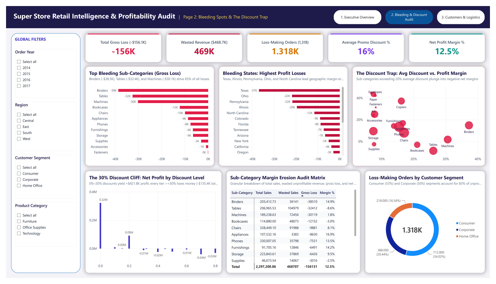
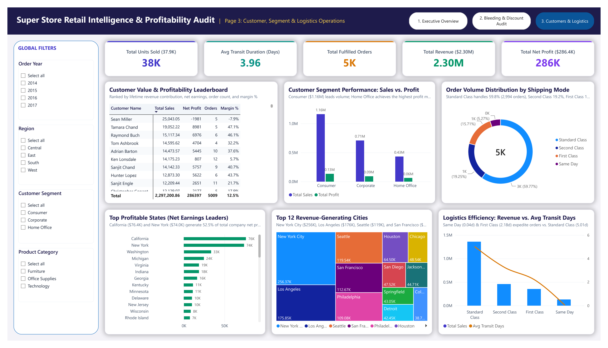
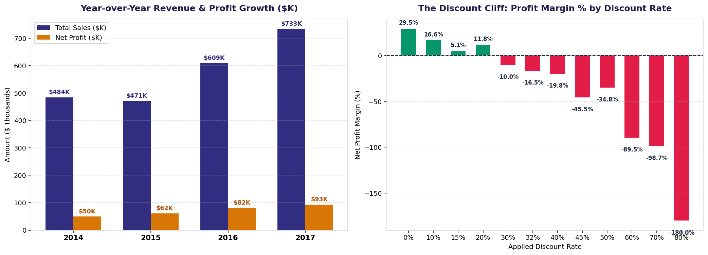
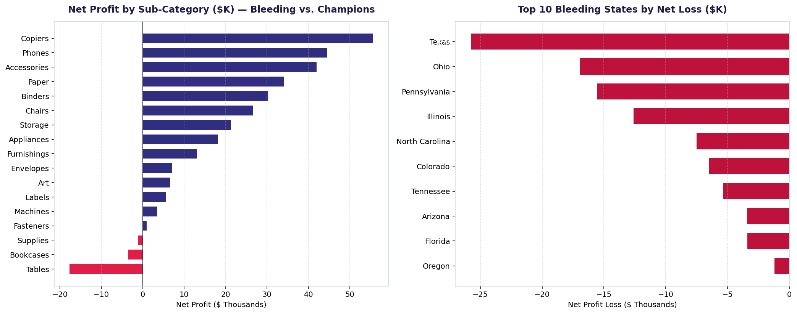
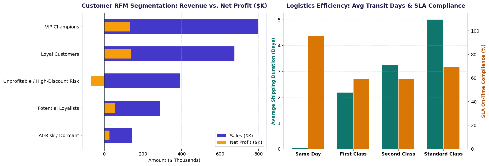

# 📊 Super Store Retail Intelligence & Profitability Audit (2014–2017)


> **End-to-End Retail Operations & Financial Analytics Portfolio Project:** Comprehensive unit economics diagnosis, automated RFM customer segmentation, logistics shipping SLA auditing, and a 3-page executive Power BI dashboard analyzing **9,994 transactions ($2.30M in Gross Sales, $286.4K Net Profit)** across the United States from **2014 to 2017**.

---

## 📌 Table of Contents
1. [Executive Summary & Business Problem](#-executive-summary--business-problem)
2. [Key Performance Indicators (Executive Benchmark)](#-key-performance-indicators-executive-benchmark)
3. [Interactive Power BI Dashboard Preview (3 Pages)](#-interactive-power-bi-dashboard-preview-3-pages)
4. [Repository Architecture](#-repository-architecture)
5. [Feature Engineering & Unit Economics Methodology](#-feature-engineering--unit-economics-methodology)
6. [SQLite Star-Schema Analytical Warehouse](#-sqlite-star-schema-analytical-warehouse)
7. [Key Business Insights & Analytical Findings](#-key-business-insights--analytical-findings)
8. [Strategic Recommendations for Leadership](#-strategic-recommendations-for-leadership)
9. [How to Run & Reproduce](#-how-to-run--reproduce)

---

## 🎯 Executive Summary & Business Problem

Retail businesses often prioritize top-line revenue expansion over bottom-line profit discipline. Without granular tracking of promotional elasticity, logistics SLAs, and customer lifetime value, aggressive discounting creates massive "profit bleeding." 

This project conducts an exhaustive corporate audit of the **Super Store** commercial dataset across four operating years (2014–2017) to uncover systemic margin erosion.

### The Core Business Dilemma:
* While total revenue expanded by **+51.4%** from **$484.2K** (2014) to **$733.2K** (2017), cumulative gross operational losses surged by **+68.8%** (from **$31.9K** to **$53.8K**).
* **18.72% of all order line items (1,871 items)** were fulfilled at an outright financial loss, destroying **$156,131.64** in operating profit.
* Over **$468,707.04 (20.40% of total company revenue)** was "wasted revenue" generated on transactions with negative margins.
* Heavy uncoordinated discounts (exceeding 20%) created a catastrophic **"Discount Cliff"**, shifting net profit margins from **+29.5%** down to **-180.0%**.

---

## 📊 Key Performance Indicators (Executive Benchmark)

| Operational & Financial Metric | Catalog Total / Performance | Analytical Significance & Thresholds |
| :--- | :---: | :--- |
| **Gross Revenue (Total Sales)** | **$2,297,200.86** (`$2.30M`) | Top-line cumulative commercial volume (2014–2017) |
| **Total Net Profit** | **$286,397.02** (`$286.4K`) | Aggregate earnings after supplier costs & line discounts |
| **Overall Profit Margin %** | **12.47%** | Base corporate operating margin across 9,994 items |
| **Total Unique Orders** | **5,009 Orders** | 9,994 individual line items fulfilled across 4 regions |
| **Unique Active Customers** | **793 Customers** | Spanning Consumer (51.9%), Corporate (30.2%), and Home Office (17.8%) |
| **Average Promo Discount** | **15.62%** | Mean promotional discount applied across catalog |
| **Total Gross Loss** | **-$156,131.64** | Direct margin destroyed on 1,871 loss-making items |
| **Wasted Revenue (Loss-Making Sales)** | **$468,707.04** (`20.40%`) | Sales volume tied up in profit-negative transactions |
| **Average Shipping Transit Duration** | **3.96 Days** | Mean transit time from order confirmation to delivery |
| **Total Units Sold** | **37,873 Units** | Physical throughput across 17 retail sub-categories |

---

## 🖥️ Interactive Power BI Dashboard Preview (3 Pages)

The Power BI dashboard ([`04_PowerBI_Dashboard/Super_Store.pbix`](04_PowerBI_Dashboard/Super_Store.pbix) and PDF export [`04_PowerBI_Dashboard/Super_Store.pdf`](04_PowerBI_Dashboard/Super_Store.pdf)) was engineered using the custom **Super Store Executive Midnight & Gold Theme** ([`Super_Store_Executive_Theme.json`](04_PowerBI_Dashboard/Super_Store_Executive_Theme.json)) with 3 modular executive report views:

### Page 1: Executive Financial Overview
> High-level corporate scorecard: Multi-year sales & profit trajectory, regional revenue breakdown, core product category split, and sub-category net profitability rankings.



---

### Page 2: Bleeding Spots & The Discount Trap
> Diagnostic deep-dive: Isolation of the top loss-driving sub-categories (Binders, Tables, Machines), geographic margin destruction hot-spots (Texas, Ohio, Pennsylvania), and empirical proof of the **20% Discount Cliff**.



---

### Page 3: Customer RFM Segmentation & Logistics Operations
> Operational efficiency: Customer lifetime value leaderboard, RFM cohort profitability, order volume distribution across shipping modes, and delivery transit speed vs. SLA compliance.



---

## 📂 Repository Architecture

```text
Super-Store-Retail-Analytics-and-Profitability-Audit/
├── .gitignore                                      <- Git exclusion rules for clean commits
├── README.md                                       <- Full executive report & technical documentation
├── 01_Data/
│   ├── Raw_Data/
│   │   └── Super_Store.csv                         <- Raw transactional dataset (9,994 records)
│   └── Processed_Data/
│       └── Clean_Super_Store.csv                   <- Enriched dataset with RFM & unit economics (40 cols)
├── 02_SQL_Warehouse/
│   ├── Super_Store.db                              <- Complete SQLite analytical data warehouse
│   └── Super_Store_Analytical_Views.sql            <- Production DDL, performance indexes & 5 BI views
├── 03_Python_Pipeline/
│   └── Super_Store.ipynb                           <- End-to-end ETL, statistical modeling & visual audit
├── 04_PowerBI_Dashboard/
│   ├── Super_Store.pbix                            <- Interactive 3-page Power BI report file
│   ├── Super_Store.pdf                             <- High-resolution PDF presentation export
│   └── Super_Store_Executive_Theme.json            <- Executive custom visual palette & typography
└── 05_Visuals/
    ├── dashboard_preview1.png                      <- Power BI Page 1 high-resolution preview
    ├── dashboard_preview2.png                      <- Power BI Page 2 high-resolution preview
    ├── dashboard_preview3.png                      <- Power BI Page 3 high-resolution preview
    ├── 01_Growth_Trajectory_and_Discount_Cliff.png  <- Python analytical chart: Growth & Discount Cliff
    ├── 02_SubCategory_Profitability_and_Bleeding_States.png <- Python analytical chart: Bleeding analysis
    └── 03_Customer_RFM_Tiers_and_Logistics_SLA.png <- Python analytical chart: RFM & Shipping SLAs
```

---

## 🔬 Feature Engineering & Unit Economics Methodology

To convert raw commercial transactions into an executive diagnostic system, the Python pipeline ([`03_Python_Pipeline/Super_Store.ipynb`](03_Python_Pipeline/Super_Store.ipynb)) formulated several key business metrics:

```python
# 1. Gross List Price & Promotional Discount Amount
Gross_Sales = Sales / (1 - Discount)
Discount_Amount = Gross_Sales - Sales

# 2. Cost of Goods Sold (COGS) Estimation
Estimated_Cost = Sales - Profit

# 3. Unit Economics & Profit Status
Profit_Margin_Pct = (Profit / Sales) * 100
Profit_Status = "Profitable" if Profit >= 0 else "Loss-Making"
Loss_Amount = abs(Profit) if Profit < 0 else 0
Wasted_Sales = Sales if Profit < 0 else 0

# 4. Logistics SLA Compliance Logic
Shipping_Duration = (Ship_Date - Order_Date).days
Target_SLA_Days = {
    "Same Day": 0,
    "First Class": 2,
    "Second Class": 3,
    "Standard Class": 5
}[Ship_Mode]
SLA_Status = "On-Time" if Shipping_Duration <= Target_SLA_Days else "Delayed"
```

### Customer RFM Segmentation Engine:
Customers were evaluated across three dimensions:
* **Recency (R):** Days elapsed from customer's latest order to the audit benchmark date (`2017-12-31`).
* **Frequency (F):** Total number of distinct historical orders placed.
* **Monetary (M):** Cumulative gross revenue generated.

Using quantile score ranking (`1` to `5`), each customer was assigned to one of five distinct strategic cohorts:
1. **VIP Champions:** High recency, high order frequency, and massive lifetime spending.
2. **Loyal Customers:** Consistent purchasing pattern with solid profitability.
3. **Potential Loyalists:** Recent buyers with moderate spend, prime candidates for cross-selling.
4. **At-Risk / Dormant:** Lapsed historical buyers who have not purchased in >180 days.
5. **Unprofitable / High-Discount Risk:** Chronic deal-hunters whose net lifetime margin is negative.

---

## 🗄️ SQLite Star-Schema Analytical Warehouse

The embedded SQLite data warehouse ([`02_SQL_Warehouse/Super_Store.db`](02_SQL_Warehouse/Super_Store.db)) provides pre-aggregated analytical views written in [`Super_Store_Analytical_Views.sql`](02_SQL_Warehouse/Super_Store_Analytical_Views.sql):

### Core Analytical Views:
1. `vw_executive_yearly_kpis`: Tracks yearly progression of sales, net earnings, active customer counts, and cumulative loss erosion.
2. `vw_subcategory_bleeding_analysis`: Summarizes units sold, margin %, discount intensity, and gross loss by category and sub-category.
3. `vw_discount_cliff_impact`: Breaks down transaction volume and profit margins across 12 distinct discount increments (0% to 80%).
4. `vw_state_profitability_ranking`: Evaluates state-level performance across the US, identifying high-margin territories vs. chronic loss sinks.
5. `vw_logistics_sla_performance`: Compares SLA compliance percentages and delivery transit speeds across all 4 shipping tiers.

---

## 📈 Key Business Insights & Analytical Findings

### 1. The 20% Discount Cliff (Profit Elasticity Breakdown)
Discounts below 20% deliver healthy margins, but exceeding 20% immediately triggers steep losses:
* **0% Discount:** Generates **$1.09M in Sales** and **$320,987.60 in Profit** (**+29.5% Margin**).
* **20% Discount:** Generates **$435.5K in Sales** and **$51,466.88 in Profit** (**+11.8% Margin**).
* **30% Discount:** Sinks to **-$13,972.48 in Net Loss** (**-10.9% Margin**).
* **50% Discount:** Sinks to **-$24,701.32 in Net Loss** (**-45.5% Margin**).
* **70%–80% Discount:** Results in extreme value destruction, with profit margins collapsing to **-89.5%** and **-180.0%**.



---

### 2. Sub-Category Unit Economics: The "Bleeding Centers"
Not all products contribute equally to enterprise value:
* **The Champions:** **Copiers** (+$55.6K profit, 37.2% margin), **Phones** (+$44.5K profit, 13.5% margin), and **Accessories** (+$41.9K profit, 25.1% margin) drive corporate profitability.
* **The Outright Bleeders:**
  * **Tables:** Net loss of **-$17,725.48** (-8.6% margin) with **$32,412.21** in gross losses driven by an average discount of **26.13%**.
  * **Bookcases:** Net loss of **-$3,472.56** (-3.0% margin) with **$12,152.29** in gross losses.
  * **Supplies:** Net loss of **-$1,189.10** (-2.5% margin).
* **The Hidden Margin Destroyers:**
  * **Binders:** While showing +$30.2K net profit on paper, Binders generated **-$38,510.57 in gross losses** on discounted units due to extreme promotions averaging **37.23%**.
  * **Machines:** Net profit of only +$3.4K against **-$30,118.71 in gross losses**.



---

### 3. Geographic Erosion: The 5 Margin Black Holes
Over **$117,000 in gross losses** are concentrated in just 5 states offering excessive discounts:
* **Texas:** **-$25,729.42 net profit** (37.0% avg discount, $36.8K gross loss).
* **Ohio:** **-$16,971.38 net profit** (32.5% avg discount, $21.8K gross loss).
* **Pennsylvania:** **-$15,559.96 net profit** (32.9% avg discount, $21.6K gross loss).
* **Illinois:** **-$12,607.89 net profit** (39.0% avg discount, $19.5K gross loss).
* **North Carolina:** **-$7,490.91 net profit** (28.4% avg discount, $11.6K gross loss).
* *In contrast:* **California** (+$76.4K profit, 7.3% discount) and **New York** (+$74.0K profit, 5.5% discount) prove that disciplined discounting yields superior earnings.

---

### 4. Customer RFM Segmentation & Chronic Risk
Analysis of 793 customers reveals acute revenue distortion:
* **VIP Champions & Loyalists (347 customers / 43.7%):** Generate **$1.47M in revenue** and **$274.5K in profit**, representing **95.8% of total company profit**.
* **Unprofitable / High-Discount Cohort (155 customers / 19.5%):** Generated **$391,950.39 in sales** but caused **-$71,224.49 in net losses**, wiping out more than a quarter of all profit made from loyal customers.



---

### 5. Logistics SLA Bottlenecks
* **Same Day Delivery:** Exceptional operational performance (**95.58% on-time** compliance, 0.04 days avg transit).
* **Expedited Shipping Hazard:** Both **First Class (40.57% delayed)** and **Second Class (41.13% delayed)** suffer severe delay rates against contractual SLA targets (2 and 3 days respectively). Customers paying premium shipping rates experience chronic delivery failures.

---

## 💡 Strategic Recommendations for Leadership

1. **Establish a Hard 20% Discount Ceiling:** Immediately restrict automated frontline discounting permissions. Require VP-level sign-off for any commercial quote exceeding 20% to eliminate the $120.8K loss sink.
2. **Restructure Furniture Unit Economics:** Re-negotiate supplier agreements for **Tables** and **Bookcases**, or shift bulky items to customer-paid shipping models to reverse negative margins.
3. **Cap Promotional Subsidies in Central & East Sinks:** Institute state-specific pricing minimums in **Texas, Ohio, Pennsylvania, and Illinois** to prevent regional promotional arbitrage.
4. **Targeted Account Management for Negative-Margin Buyers:** Eliminate blanket discounting for the 155 identified deal-seeking accounts; enforce minimum order sizes and profitable product mix bundles.
5. **Re-calibrate Logistics Carrier SLAs:** Renegotiate carrier contracts for First Class and Second Class delivery routes to close the 41% delay gap and safeguard customer retention.

---

## 🚀 How to Run & Reproduce

### 1. Clone the Repository
```bash
git clone https://github.com/beshomagdy2050/Super-Store-Retail-Analytics-and-Profitability-Audit.git
cd Super-Store-Retail-Analytics-and-Profitability-Audit
```

### 2. Set Up Python Environment & Run Pipeline
```bash
# Create virtual environment
python -m venv venv
source venv/bin/activate  # On Windows: venv\Scripts\activate

# Install dependencies
pip install pandas numpy matplotlib seaborn jupyter sqlite3

# Launch Jupyter Notebook
jupyter notebook 03_Python_Pipeline/Super_Store.ipynb
```

### 3. Query the SQLite Analytical Warehouse
```bash
sqlite3 02_SQL_Warehouse/Super_Store.db < 02_SQL_Warehouse/Super_Store_Analytical_Views.sql
```

### 4. Explore Power BI Dashboard
* Open [`04_PowerBI_Dashboard/Super_Store.pbix`](04_PowerBI_Dashboard/Super_Store.pbix) in **Power BI Desktop**.
* Review pre-loaded custom theme [`04_PowerBI_Dashboard/Super_Store_Executive_Theme.json`](04_PowerBI_Dashboard/Super_Store_Executive_Theme.json).
* Alternatively, view the exported high-resolution PDF presentation [`04_PowerBI_Dashboard/Super_Store.pdf`](04_PowerBI_Dashboard/Super_Store.pdf).

---

## 📜 License & Acknowledgments
* **Dataset:** Super Store Sales Dataset (Public domain retail benchmark).
* **License:** MIT License. Built for executive commercial analytics, portfolio presentation, and BI demonstration.
